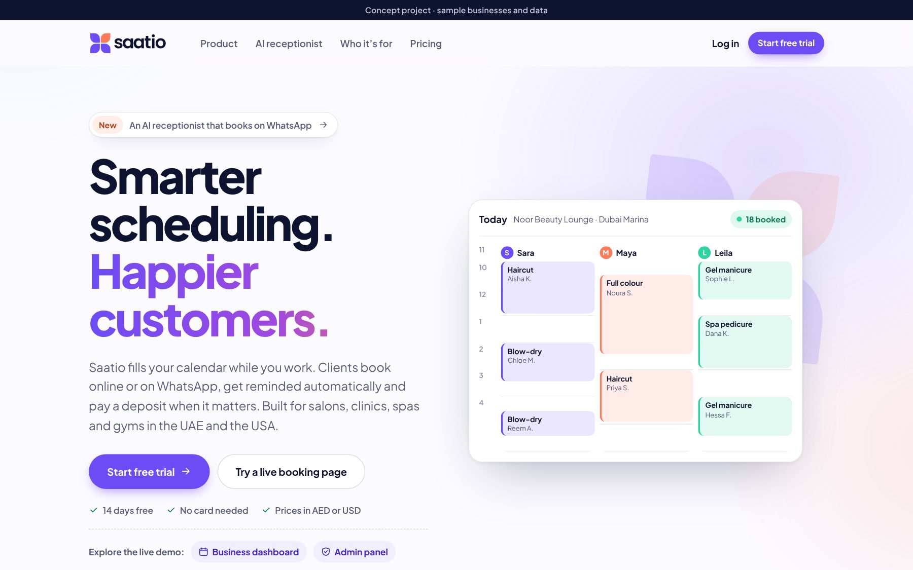
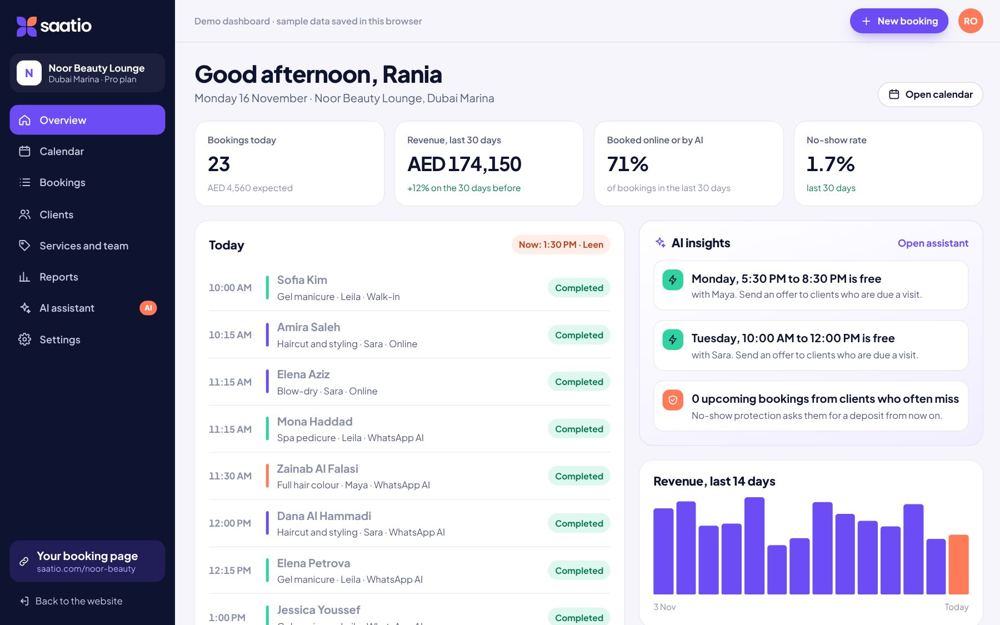

# Saatio

**Booking and scheduling SaaS with an AI receptionist** · designed and built by **Arooj Fatima**

Saatio is booking software for salons, clinics, spas and gyms in the UAE and the USA. An AI receptionist answers WhatsApp messages in English, Arabic and Roman Urdu and books appointments from live availability. The product has a marketing website, a client booking page, a business dashboard and a platform super-admin.

## Tech
- React 19
- TypeScript
- esbuild
- i18n (EN / AR / Roman Urdu)

## Notes
Self-initiated concept project with sample data, built to the standard of client work. No real bookings, orders or payments are made.

The full case study, with the design decisions behind it, is on my portfolio.

---

## Project details
A concept project by Arooj Fatima. Saatio is booking software with an AI receptionist for salons, clinics, spas and gyms in the UAE and the USA. Sample businesses and data; nothing is booked, charged or sent.

## What's inside
- **Marketing website**: hero with a live product demo, features, AI receptionist, industries, how it works, pricing teaser.
- **Pricing**: monthly or yearly, AED or USD, comparison table and FAQ. Prices come from the super-admin.
- **Sign-up**: business type, details and plan. Creates a trial that appears in the super-admin.
- **Booking page** (`#book`): what a client sees for the demo business, Noor Beauty Lounge (Dubai Marina). Real availability, deposits for clients who often miss, confirmation.
- **Business dashboard** (`#app`): overview, drag-and-drop calendar, bookings, clients, services and team, reports, AI assistant (WhatsApp receptionist simulator, smart gaps, no-show protection), settings.
- **Super-admin** (`#admin`): platform overview with MRR, businesses, plans and pricing editor.

Everything shares one store saved in the browser (`saatio-demo-v6`), so a booking made on the booking page or by the AI appears in the dashboard, and a sign-up appears in the super-admin.

## Brand
Logo: approved symbol (four petals, one coral "booked" slot) with the Poppins SemiBold wordmark, rebuilt as SVG in `src/assets`. Colours: Electric Violet #6C4CF5, Coral #FF7A59, Midnight #0E1330, Mint #2ED3A0, Soft Lilac #F1EEFF. UI font: Plus Jakarta Sans.

## Build
`node preview/build.mjs` writes `dist/index.html` and a single-file `dist/saatio.html`.

## Production plan
Next.js (App Router) front end: `/`, `/pricing`, `/signup`, `/book/[slug]`, `/app/*`, `/admin/*`.
Laravel API with MySQL, multi-tenant by business:
- `GET /api/businesses/{slug}`, `GET /api/businesses/{slug}/availability?service=&staff=&date=`
- `POST /api/bookings`, `PATCH /api/bookings/{id}` (move, status), `GET /api/bookings?date=&status=`
- `GET|POST|PATCH /api/services`, `/api/staff`, `/api/customers`
- `GET /api/reports/summary?from=&to=`
- `POST /api/ai/whatsapp/webhook` (WhatsApp Business API → LLM with tools: check availability, book, move, cancel, hand over)
- `GET /api/ai/gaps`, `POST /api/campaigns`
- Payments: Stripe (USD) and a UAE gateway (AED) for deposits and subscriptions
- Super-admin: `GET /api/admin/tenants`, `PATCH /api/admin/tenants/{id}`, `GET|PUT /api/admin/plans`

The AI receptionist in this demo is rule-based so it works offline; in production it is an AI model connected to the same calendar.

---

**Arooj Fatima** · Full-stack developer who designs · Portfolio: [aroojfatima-portfolio.netlify.app](https://aroojfatima-portfolio.netlify.app) · aroojfatimaofficial250@gmail.com
